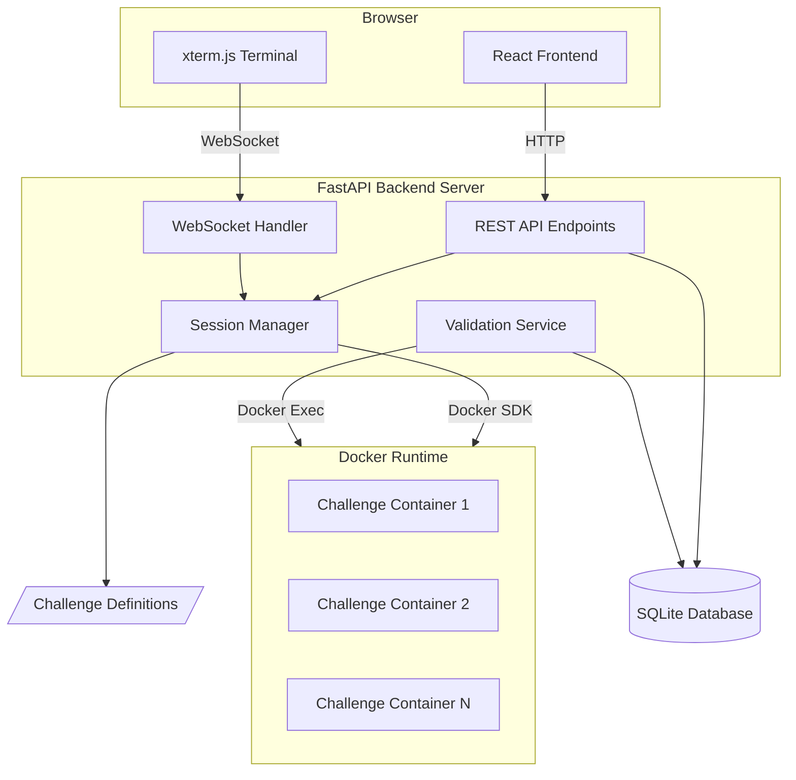

# Design Document: DevOps Arena

## Overview

DevOps Arena is a browser-based platform for practicing incident troubleshooting in isolated Docker containers. The system consists of four main layers:

1. **Frontend Layer**: React/Vite application with xterm.js terminal emulation
2. **Backend Layer**: FastAPI Python server handling HTTP APIs and WebSocket connections
3. **Container Layer**: Isolated Docker environments where users debug challenges
4. **Storage Layer**: SQLite database for user data, attempts, and leaderboards

The core user flow involves authentication, selecting a challenge, receiving an isolated container with an injected fault, debugging via browser terminal, and validating the fix. The platform emphasizes security isolation, resource constraints, and automated validation.

**Key Design Decisions:**

- **WebSocket-based terminal**: Real-time bidirectional communication between browser and container shell using xterm.js and Docker exec
- **Stateless sessions**: Each challenge attempt creates a fresh container; no persistent state between attempts
- **Challenge-as-code**: All challenges defined as structured directories with Dockerfile, setup script, validation script, and metadata
- **Security-first containers**: Non-root users, dropped capabilities, network isolation, resource limits, read-only filesystem where possible
- **Single-server deployment**: Designed for AWS EC2 free-tier with Docker Compose orchestration

## Architecture

### High-Level Component Diagram



### System Layers

#### 1. Frontend Layer (React + Vite)

**Purpose**: Provide user interface and terminal emulation in the browser

**Components**:
- **Authentication UI**: Login form with username/password
- **Challenge List View**: Browse challenges with difficulty tags and completion status
- **Challenge Detail View**: Display challenge brief and session controls
- **Terminal Component**: xterm.js instance connected via WebSocket
- **Leaderboard View**: Display ranked users by challenge completion

**Technology Stack**:
- React 18+ for component-based UI
- Vite for fast development and optimized production builds
- Tailwind CSS for responsive styling
- xterm.js for terminal rendering
- WebSocket API for real-time terminal communication

**Key Patterns**:
- Component composition for reusability
- React Context for authentication state
- Custom hooks for WebSocket connection management
- Error boundaries for graceful degradation

#### 2. Backend Layer (FastAPI + Python)

**Purpose**: Handle authentication, session management, container lifecycle, and validation

**Components**:

**a) REST API Module**
- User authentication endpoints (login, session validation)
- Challenge listing and detail endpoints
- Session creation endpoint
- Validation trigger endpoint
- Leaderboard query endpoint

**b) WebSocket Handler**
- Accepts WebSocket connections from frontend terminal
- Bridges terminal input/output between browser and container
- Maintains mapping of WebSocket connections to container sessions
- Handles connection cleanup on disconnect

**c) Session Manager**
- Creates Docker containers from challenge images
- Applies security constraints (resource limits, capabilities, network isolation)
- Tracks active sessions with timeout timers
- Terminates containers on timeout or user request
- Executes challenge setup scripts post-container creation

**d) Validation Service**
- Executes validation scripts inside containers via Docker exec
- Parses validation script exit codes and output
- Records successful attempts in database with completion time
- Returns hints on failed validation

**Technology Stack**:
- FastAPI for async HTTP and WebSocket support
- Docker SDK for Python for container operations
- SQLAlchemy for database ORM
- Pydantic for request/response validation
- asyncio for concurrent session management

#### 3. Container Layer (Docker)

**Purpose**: Provide isolated, reproducible challenge environments

**Container Characteristics**:
- Built from challenge-specific Dockerfiles
- Run with injected faults (via setup scripts)
- Non-root user execution (user ID 1000)
- Resource constraints: 0.5 CPU cores, 256MB memory
- Network isolation: no egress allowed
- Dropped Linux capabilities (all except CHOWN, DAC_OVERRIDE, FOWNER, SETGID, SETUID, NET_BIND_SERVICE)
- Read-only root filesystem where challenges allow
- No access to Docker socket or host filesystem
- Ephemeral: destroyed after session end or timeout

**Container Lifecycle**:
1. Session Manager pulls/builds challenge image
2. Container created with security constraints
3. Setup script executed to inject fault
4. Terminal WebSocket connected to container shell via `docker exec`
5. User debugs via terminal
6. Validation script executed on demand
7. Container stopped and removed on completion/timeout

#### 4. Storage Layer (SQLite)

**Purpose**: Persist user data, attempts, and leaderboards

**Database Schema** (detailed in Data Models section below)

## Components and Interfaces

### Frontend Components

#### 1. AuthContext
**Responsibility**: Manage authentication state globally

**State**:
- `user`: Current authenticated user object or null
- `token`: JWT or session token
- `isAuthenticated`: Boolean flag

**Methods**:
- `login(username, password)`: Authenticate and store token
- `logout()`: Clear authentication state
- `checkAuth()`: Validate token on app load

#### 2. TerminalComponent
**Responsibility**: Render terminal and manage WebSocket connection

**Props**:
- `sessionId`: Unique session identifier
- `websocketUrl`: Backend WebSocket endpoint

**State**:
- `terminal`: xterm.js Terminal instance
- `socket`: WebSocket connection
- `connected`: Connection status

**Methods**:
- `connectWebSocket()`: Establish WebSocket to backend
- `handleTerminalData(data)`: Send user input to WebSocket
- `handleWebSocketMessage(event)`: Write remote output to terminal
- `cleanup()`: Disconnect and destroy terminal on unmount

**Key Implementation Details**:
```javascript
// Terminal initialization with xterm.js
const terminal = new Terminal({
  cursorBlink: true,
  fontSize: 14,
  fontFamily: 'Menlo, Monaco, "Courier New", monospace',
  theme: { background: '#1e1e1e' }
});

// WebSocket message handling
socket.onmessage = (event) => {
  terminal.write(event.data); // Write remote output to terminal
};

terminal.onData((data) => {
  socket.send(data); // Send user input to backend
});
```

#### 3. ChallengeListComponent
**Responsibility**: Display available challenges

**Data Fetched**:
- Challenge metadata (title, difficulty, brief)
- User completion status

**Interactions**:
- Click challenge → navigate to ChallengeDetailView

#### 4. ChallengeDetailComponent
**Responsibility**: Display challenge details and control session

**State**:
- `challenge`: Challenge metadata
- `session`: Active session object or null
- `timeRemaining`: Countdown timer

**Methods**:
- `startSession()`: POST to backend to create container session
- `validateSolution()`: Trigger validation endpoint
- `endSession()`: Explicitly terminate session

#### 5. LeaderboardComponent
**Responsibility**: Display ranked users

**Data Fetched**:
- Leaderboard entries (username, completion time, rank)

**Filtering**:
- Option to view global or per-challenge leaderboard

### Backend Components

#### 1. Authentication Module

**Endpoints**:
- `POST /api/auth/login`: Authenticate user
- `GET /api/auth/me`: Get current user info

**Request/Response Models**:
```python
class LoginRequest(BaseModel):
    username: str
    password: str

class LoginResponse(BaseModel):
    token: str
    user: UserResponse
```

**Security**:
- Password hashing with bcrypt or argon2
- JWT token generation with expiry
- Token validation middleware for protected endpoints

#### 2. Challenge API Module

**Endpoints**:
- `GET /api/challenges`: List all challenges
- `GET /api/challenges/{id}`: Get challenge details
- `POST /api/sessions`: Create new challenge session
- `DELETE /api/sessions/{id}`: Terminate session
- `POST /api/sessions/{id}/validate`: Run validation

**Request/Response Models**:
```python
class ChallengeResponse(BaseModel):
    id: str
    title: str
    difficulty: str
    brief: str
    completed: bool  # For authenticated user

class SessionCreateRequest(BaseModel):
    challenge_id: str

class SessionResponse(BaseModel):
    session_id: str
    container_id: str
    websocket_url: str
    timeout_seconds: int

class ValidationResponse(BaseModel):
    success: bool
    message: str
    hint: Optional[str]
```

#### 3. WebSocket Handler

**Endpoint**: `ws://backend/api/sessions/{session_id}/terminal`

**Connection Flow**:
1. Frontend opens WebSocket connection with session_id
2. Backend validates session exists and user owns it
3. Backend spawns Docker exec process attached to container: `docker exec -it <container_id> /bin/bash`
4. Backend creates bidirectional pipe: WebSocket ↔ Docker exec stdin/stdout
5. User types in browser → WebSocket → Docker exec stdin → container shell
6. Container shell output → Docker exec stdout → WebSocket → browser terminal

**Message Format**:
- Text-based: raw terminal bytes as strings
- Binary mode optional for efficiency

**Implementation Pattern** (using Docker SDK for Python):
```python
import docker
from fastapi import WebSocket

async def terminal_websocket(websocket: WebSocket, session_id: str):
    await websocket.accept()
    
    session = get_session(session_id)
    container = docker_client.containers.get(session.container_id)
    
    # Start exec instance for bash shell
    exec_instance = container.exec_run(
        cmd="/bin/bash",
        stdin=True,
        stdout=True,
        stderr=True,
        tty=True,
        socket=True
    )
    
    # Bidirectional relay
    asyncio.create_task(relay_websocket_to_exec(websocket, exec_instance))
    asyncio.create_task(relay_exec_to_websocket(exec_instance, websocket))
```

**Error Handling**:
- Container not found → close WebSocket with error code
- Container stopped → notify frontend and close gracefully
- WebSocket disconnect → terminate exec process

#### 4. Session Manager

**Responsibilities**:
- Container lifecycle management
- Timeout enforcement
- Resource tracking

**Data Structures**:
```python
class Session:
    session_id: str
    user_id: str
    challenge_id: str
    container_id: str
    created_at: datetime
    timeout_at: datetime
    status: str  # 'active', 'completed', 'timeout', 'terminated'
```

**Methods**:

**`create_session(user_id: str, challenge_id: str) -> Session`**
1. Load challenge definition from filesystem
2. Build/pull Docker image if needed
3. Create container with security constraints:
   ```python
   container = docker_client.containers.create(
       image=challenge_image,
       user="1000:1000",  # Non-root
       network_mode="none",  # No network
       mem_limit="256m",
       cpu_period=100000,
       cpu_quota=50000,  # 0.5 cores
       cap_drop=["ALL"],
       cap_add=["CHOWN", "DAC_OVERRIDE", "FOWNER", "SETGID", "SETUID", "NET_BIND_SERVICE"],
       read_only=challenge.get("read_only", False),
       detach=True
   )
   ```
4. Start container
5. Execute setup script to inject fault
6. Store session in database and in-memory tracker
7. Schedule timeout task
8. Return session object

**`terminate_session(session_id: str)`**
1. Stop container gracefully (10s timeout)
2. Remove container and associated resources
3. Update session status in database
4. Clean up in-memory tracking

**`enforce_timeout(session_id: str)`**
1. Check if session exceeded 30 minutes
2. Forcefully stop and remove container
3. Update session status to 'timeout'
4. Notify frontend via WebSocket if connected

**Resource Tracking**:
- Maintain in-memory dict: `{session_id: Session}`
- Periodic cleanup task to remove stale references
- Prevent resource leaks by ensuring removal on all exit paths

#### 5. Validation Service

**Responsibilities**:
- Execute validation scripts inside containers
- Parse results and record successful attempts
- Return hints on failure

**Method**:

**`validate_solution(session_id: str, user_id: str) -> ValidationResponse`**
1. Verify session exists and belongs to user
2. Get container from session
3. Execute validation script:
   ```python
   result = container.exec_run(
       cmd="/bin/bash /challenge/validate.sh",
       user="1000:1000"
   )
   ```
4. Check exit code:
   - Exit 0 → Success:
     - Calculate completion time (current_time - session.created_at)
     - Record attempt in database
     - Update leaderboard
     - Return success response
   - Non-zero exit → Failure:
     - Parse stdout for hint message
     - Return failure response with hint

**Validation Script Contract**:
- Exit 0 if challenge is fixed
- Exit non-zero if challenge remains broken
- Print hint message to stdout on failure

#### 6. Leaderboard Service

**Responsibilities**:
- Query and rank users by completion

**Methods**:

**`get_global_leaderboard() -> List[LeaderboardEntry]`**
- Query users with count of completed challenges
- Order by completion count descending, then total time ascending

**`get_challenge_leaderboard(challenge_id: str) -> List[LeaderboardEntry]`**
- Query successful attempts for specific challenge
- Order by completion time ascending
- Return ranked list

### Challenge Definition Structure

Each challenge is a directory under `/challenges/` with the following files:

**Directory Structure**:
```
/challenges/
  ├── docker-restart-loop/
  │   ├── Dockerfile
  │   ├── setup.sh
  │   ├── validate.sh
  │   └── metadata.json
  ├── disk-full/
  │   ├── Dockerfile
  │   ├── setup.sh
  │   ├── validate.sh
  │   └── metadata.json
  └── ...
```

**1. Dockerfile**

Defines base container image. Example:
```dockerfile
FROM ubuntu:22.04

RUN apt-get update && apt-get install -y \
    nginx \
    curl \
    vim \
    && rm -rf /var/lib/apt/lists/*

RUN useradd -m -u 1000 challenger

WORKDIR /challenge
COPY setup.sh validate.sh /challenge/
RUN chmod +x /challenge/*.sh

USER challenger
CMD ["/bin/bash"]
```

**2. setup.sh**

Injects the fault. Executed after container start. Example (Nginx 502):
```bash
#!/bin/bash
# Break Nginx by misconfiguring upstream
echo "upstream backend { server 127.0.0.1:9999; }" > /etc/nginx/conf.d/backend.conf
echo "server { location / { proxy_pass http://backend; } }" >> /etc/nginx/conf.d/backend.conf
systemctl restart nginx
```

**3. validate.sh**

Checks if issue is resolved. Exit 0 = success. Example:
```bash
#!/bin/bash
# Check if Nginx returns 200 OK
response=$(curl -s -o /dev/null -w "%{http_code}" http://localhost)
if [ "$response" = "200" ]; then
    exit 0
else
    echo "Hint: Check Nginx error logs and upstream configuration"
    exit 1
fi
```

**4. metadata.json**

Challenge metadata. Example:
```json
{
  "id": "nginx-502",
  "title": "Fix Nginx 502 Bad Gateway",
  "difficulty": "medium",
  "brief": "The Nginx server is returning 502 errors. Identify and fix the configuration issue.",
  "hints": [
    "Check /var/log/nginx/error.log",
    "Verify upstream server configuration"
  ]
}
```

**Loading Process**:
1. On backend startup, scan `/challenges/` directory
2. For each subdirectory, load `metadata.json`
3. Store challenge definitions in memory
4. Build Docker images if not already built (during development) or use pre-built images (production)

## Data Models

### Database Schema (SQLite)

#### users
| Column | Type | Constraints |
|--------|------|-------------|
| id | INTEGER | PRIMARY KEY AUTOINCREMENT |
| username | TEXT | UNIQUE, NOT NULL |
| password_hash | TEXT | NOT NULL |
| created_at | DATETIME | DEFAULT CURRENT_TIMESTAMP |

#### challenges
| Column | Type | Constraints |
|--------|------|-------------|
| id | TEXT | PRIMARY KEY |
| title | TEXT | NOT NULL |
| difficulty | TEXT | NOT NULL |
| brief | TEXT | NOT NULL |
| metadata | TEXT | JSON |

#### sessions
| Column | Type | Constraints |
|--------|------|-------------|
| id | TEXT | PRIMARY KEY |
| user_id | INTEGER | FOREIGN KEY REFERENCES users(id) |
| challenge_id | TEXT | FOREIGN KEY REFERENCES challenges(id) |
| container_id | TEXT | NOT NULL |
| status | TEXT | NOT NULL |
| created_at | DATETIME | DEFAULT CURRENT_TIMESTAMP |
| timeout_at | DATETIME | NOT NULL |
| terminated_at | DATETIME | NULL |

#### attempts
| Column | Type | Constraints |
|--------|------|-------------|
| id | INTEGER | PRIMARY KEY AUTOINCREMENT |
| user_id | INTEGER | FOREIGN KEY REFERENCES users(id) |
| challenge_id | TEXT | FOREIGN KEY REFERENCES challenges(id) |
| session_id | TEXT | FOREIGN KEY REFERENCES sessions(id) |
| success | BOOLEAN | NOT NULL |
| completion_time_seconds | INTEGER | NULL |
| created_at | DATETIME | DEFAULT CURRENT_TIMESTAMP |

**Indexes**:
- `idx_attempts_user_challenge` on `(user_id, challenge_id)` for completion status queries
- `idx_attempts_challenge_success` on `(challenge_id, success, completion_time_seconds)` for leaderboard queries

### API Models (Pydantic)

Defined in Backend Components section above.

## Error Handling

### Frontend Error Handling

**Network Errors**:
- API request failures → Display error message, retry button
- WebSocket disconnect → Show "Connection lost" indicator, attempt reconnection

**Session Errors**:
- Session creation timeout → Notify user, suggest retry
- Session not found (expired/invalid) → Redirect to challenge list

**User-Facing Messages**:
- Clear, actionable error text
- Avoid exposing internal error details

### Backend Error Handling

**Container Errors**:
- Container creation failure → Return 503 Service Unavailable with retry-after header
- Container not found → Return 404 Not Found
- Docker daemon unreachable → Log critical error, return 500

**Validation Errors**:
- Invalid request payloads → Return 400 Bad Request with field errors
- Unauthorized access → Return 401 Unauthorized
- Session ownership mismatch → Return 403 Forbidden

**Resource Exhaustion**:
- Too many active containers → Return 503 with "Capacity limit reached" message
- Database connection failure → Return 500, retry internally with exponential backoff

**Logging**:
- Structured logging with levels (DEBUG, INFO, WARNING, ERROR, CRITICAL)
- Log all container lifecycle events (create, start, stop, remove)
- Log authentication events (login, failed attempts)
- Log validation attempts and results
- Avoid logging sensitive data (passwords, tokens)


## Testing Strategy

### Unit Testing

**Frontend Unit Tests** (Vitest + React Testing Library):
- Component rendering with various props
- User interaction handlers (button clicks, form submissions)
- Authentication context state management
- WebSocket connection state transitions

**Backend Unit Tests** (pytest):
- Authentication logic (password hashing, token generation/validation)
- Request/response model validation
- Session creation logic with mocked Docker client
- Session termination and cleanup
- Validation result parsing
- Leaderboard ranking logic

**Test Coverage Goals**:
- Aim for >80% code coverage
- Focus on critical paths (authentication, session management, validation)

### Integration Testing

**Backend Integration Tests**:
- Full API request/response cycle with test database
- Container lifecycle with Docker-in-Docker or test containers
- WebSocket connection establishment and data relay
- Validation script execution against real challenge containers
- Database transaction integrity

**Test Scenarios**:
1. User authenticates → creates session → connects terminal → validates solution → sees leaderboard update
2. Session timeout enforcement → container terminated and cleaned up
3. Multiple concurrent sessions for different users
4. Challenge validation with success and failure cases

### End-to-End Testing

**E2E Tests** (Playwright or Cypress):
- Complete user flow: login → browse challenges → start session → connect terminal → interact → validate
- Terminal functionality: type commands, see output
- Timeout behavior: session terminates after 30 minutes
- Leaderboard updates after successful completion

**Test Environment**:
- Full stack running (frontend, backend, Docker, database)
- Pre-seeded test user and challenges
- Automated teardown after test completion

### Security Testing

**Vulnerability Scanning**:
- Container image scanning with Trivy or Snyk
- Dependency vulnerability checks (npm audit, pip-audit)

**Penetration Testing Scenarios**:
- Attempt container escape
- Attempt to access host filesystem
- Attempt to access other users' sessions
- Attempt to bypass network isolation
- Attempt SQL injection in API endpoints
- Attempt authentication bypass

**Manual Security Review**:
- Code review focused on Docker SDK usage
- Review of Linux capability dropping
- Review of user input validation
- Review of authentication token handling

