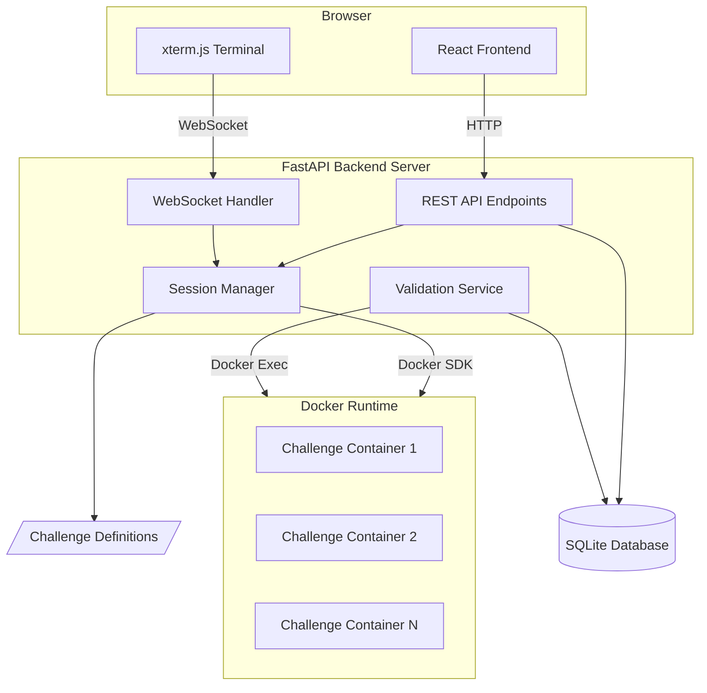

# DevOps Arena

A browser-based interactive learning platform for practicing DevOps troubleshooting in isolated sandbox environments.

## Overview

DevOps Arena provides real-world incident scenarios where users debug broken infrastructure in isolated Docker containers, validate their fixes, and compete on leaderboards—similar to LeetCode but for operational troubleshooting.

## Architecture



## Project Structure

```
devops-arena/
├── frontend/              # React + Vite frontend
│   ├── src/
│   │   ├── components/   # React components
│   │   ├── context/      # React context (auth, etc.)
│   │   ├── pages/        # Page components
│   │   └── hooks/        # Custom hooks
│   └── package.json
├── backend/              # FastAPI backend
│   ├── app/
│   │   ├── models/      # SQLAlchemy models
│   │   ├── routers/     # API endpoints
│   │   ├── schemas/     # Pydantic schemas
│   │   ├── services/    # Business logic
│   │   └── main.py      # Application entry point
│   └── requirements.txt
├── challenges/           # Challenge definitions
│   └── [challenge-name]/
│       ├── Dockerfile
│       ├── setup.sh
│       ├── validate.sh
│       └── metadata.json
└── docker-compose.yml    # Local development setup
```

## Local Development Setup

### Prerequisites

- Docker and Docker Compose
- Node.js 20+ (if running frontend locally)
- Python 3.11+ (if running backend locally)

### Quick Start with Docker Compose

1. Clone the repository:
```bash
git clone <repository-url>
cd devops-arena
```

2. Start all services:
```bash
docker-compose up --build
```

3. Access the application:
- Frontend: http://localhost:5173
- Backend API: http://localhost:8000
- API Documentation: http://localhost:8000/docs

### Local Development (without Docker Compose)

#### Backend Setup

```bash
cd backend
python -m venv venv
source venv/bin/activate  # On Windows: venv\Scripts\activate
pip install -r requirements.txt
pip install -r requirements-dev.txt
uvicorn app.main:app --reload
```

#### Frontend Setup

```bash
cd frontend
npm install
npm run dev
```

## Technology Stack

### Frontend
- **React 18**: UI framework
- **Vite**: Build tool and dev server
- **Tailwind CSS**: Styling
- **xterm.js**: Terminal emulation
- **React Router**: Navigation

### Backend
- **FastAPI**: Web framework
- **SQLAlchemy**: ORM
- **SQLite**: Database
- **Docker SDK for Python**: Container management
- **python-jose**: JWT authentication
- **passlib**: Password hashing

## Features

- 🔐 User authentication with JWT
- 📋 Browse challenges with difficulty levels
- 🐳 Isolated Docker sandbox environments
- 💻 Browser-based terminal interface
- ✅ Automated solution validation
- 🏆 Leaderboard rankings
- ⏱️ Session timeout enforcement
- 🔒 Security-hardened containers

## Demo

<!-- TODO: Add demo GIF here -->

## Deployment

### AWS EC2 Free-Tier Deployment

1. Launch an EC2 instance (t2.micro)
2. Install Docker and Docker Compose
3. Clone the repository
4. Update environment variables in `docker-compose.yml`
5. Run `docker-compose up -d`

Detailed deployment instructions coming soon.

## Contributing

Contributions are welcome! Please read our contributing guidelines before submitting PRs.

## License

MIT License - see LICENSE file for details

## Contact

For questions or issues, please open a GitHub issue.
