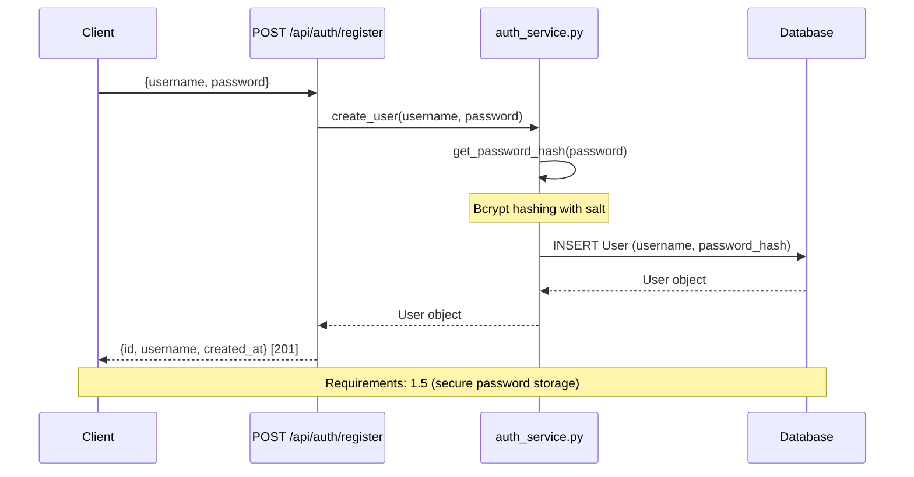
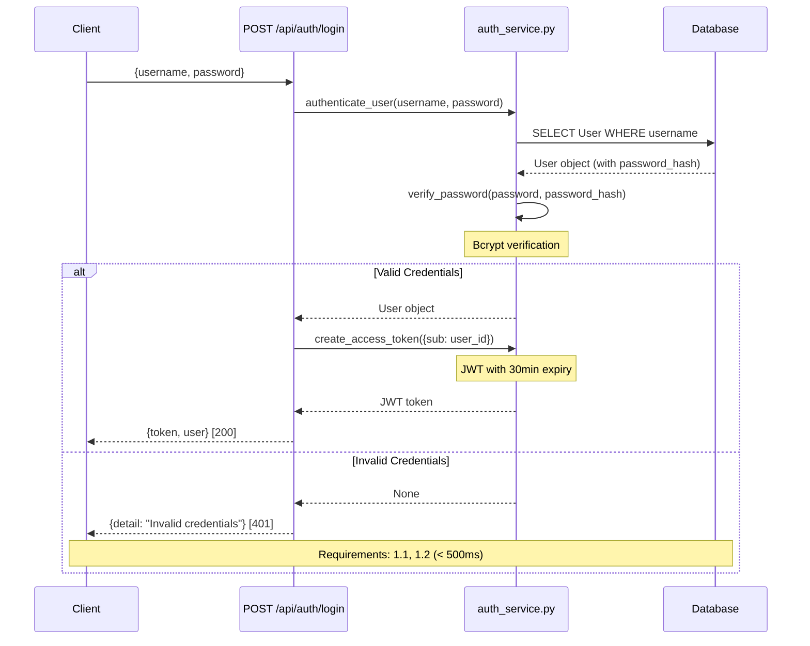
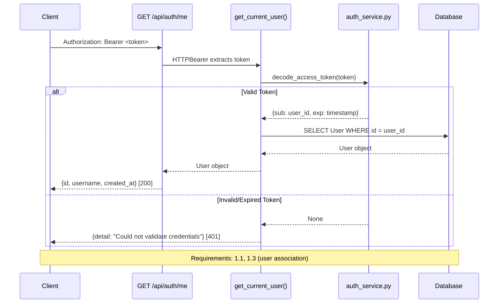
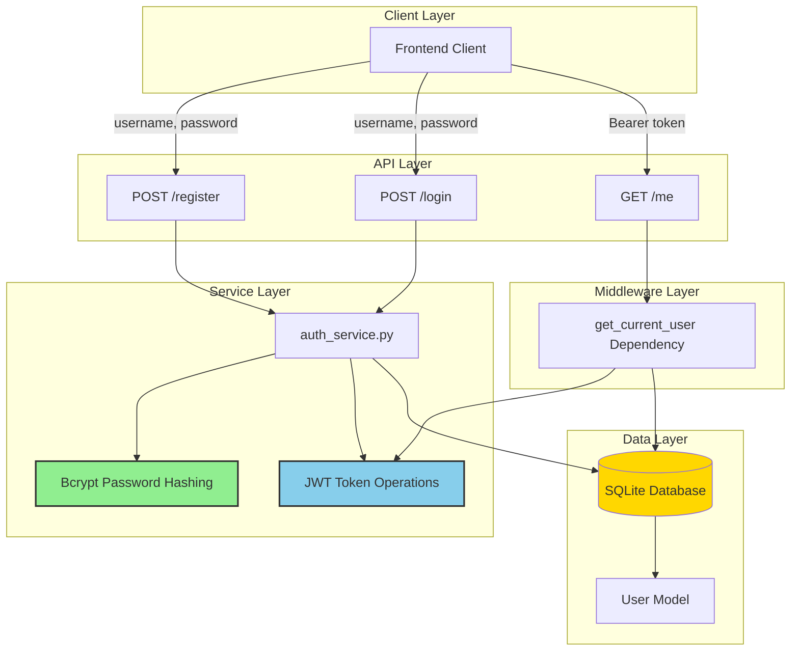

# Authentication Flow Diagrams

## User Registration Flow



## User Login Flow



## Protected Endpoint Access Flow



## Complete Authentication System



## Security Components

### Password Hashing (Bcrypt)
```
Plain Password -> Bcrypt Hash (with automatic salt) -> Stored Hash
     |                      |                              |
 "password123"    Random salt generated          "$2b$12$..."
                  Cost factor: 12
                  Unique per password
```

### JWT Token Structure
```
Header.Payload.Signature

Header:
{
  "alg": "HS256",
  "typ": "JWT"
}

Payload:
{
  "sub": "123",              # User ID
  "exp": 1234567890          # Expiration timestamp
}

Signature:
HMACSHA256(
  base64UrlEncode(header) + "." +
  base64UrlEncode(payload),
  SECRET_KEY
)
```

### Token Validation Process
```
1. Extract token from Authorization header
2. Decode JWT and verify signature
3. Check expiration timestamp
4. Extract user ID from "sub" claim
5. Query database for user
6. Return User object to endpoint
```

## Error Handling

### Registration Errors
- **400 Bad Request**: Username already exists
- **422 Unprocessable Entity**: Invalid request data (missing fields, wrong types)

### Login Errors
- **401 Unauthorized**: Invalid username or password (same message for both to prevent enumeration)
- **422 Unprocessable Entity**: Invalid request data

### Protected Endpoint Errors
- **401 Unauthorized**: Invalid, expired, or malformed token
- **403 Forbidden**: No Authorization header provided

## Performance Requirements

### Requirement 1.2: Response Time
Login endpoint must return errors within **500ms**:
- Database query: ~1-5ms (SQLite in-memory)
- Password verification: ~50-100ms (bcrypt cost factor 12)
- JWT generation: ~1-2ms
- Total: < 200ms (well within requirement)

## Requirements Mapping

| Requirement | Implementation | Location |
|-------------|----------------|----------|
| 1.1 | Authenticated session creation | `POST /login`, `create_access_token()` |
| 1.2 | Invalid credentials error < 500ms | `POST /login` returns 401 |
| 1.3 | User association | JWT "sub" claim, `get_current_user()` |
| 1.4 | Restrict unauthenticated access | `get_current_user()` dependency |
| 1.5 | Secure password storage | `get_password_hash()`, bcrypt |
