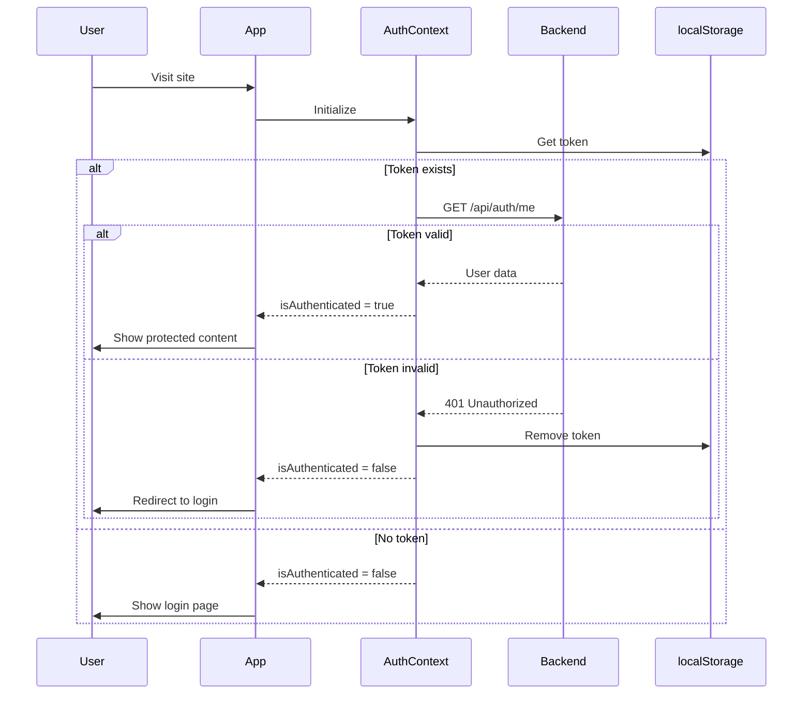
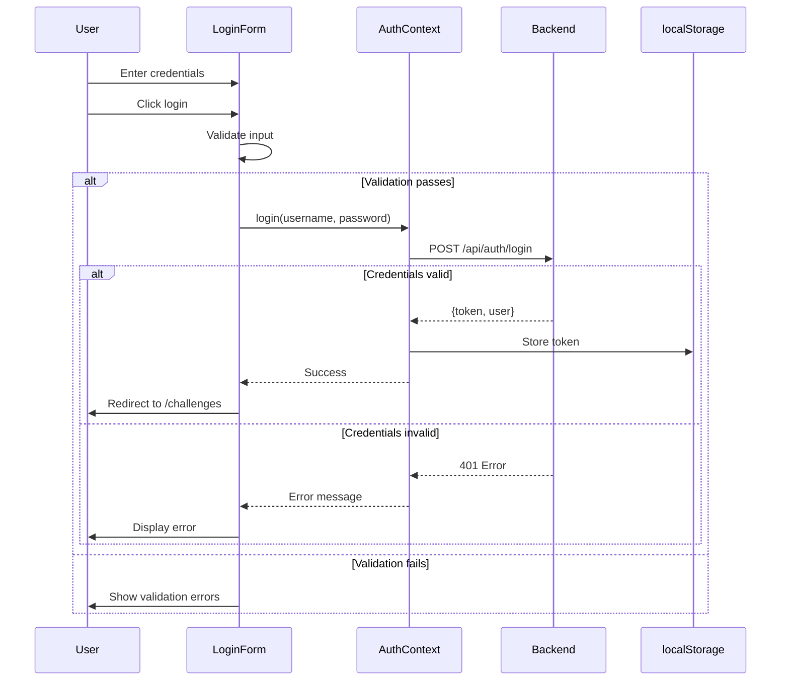
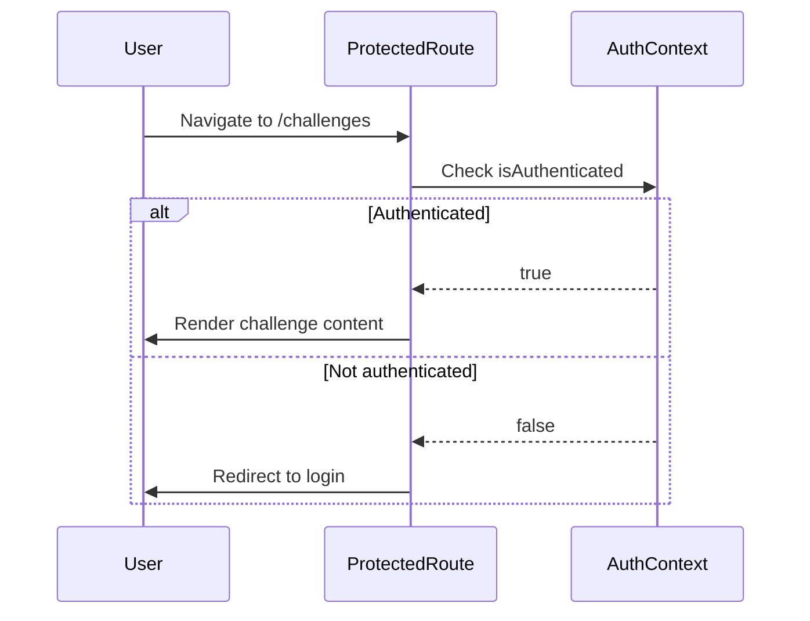

# Authentication Implementation

## Overview

This document describes the frontend authentication implementation for DevOps Arena, including login form, authentication context, protected routes, and session persistence.

## Requirements Coverage

| Requirement | Description | Implementation |
|-------------|-------------|----------------|
| 1.1 | Create authenticated session on valid login | `AuthContext.login()` creates session with JWT token |
| 1.2 | Return error within 500ms on invalid credentials | Login form displays server error messages |
| 1.3 | Associate attempts with authenticated user | JWT token included in all API requests via `api.js` utils |
| 1.4 | Restrict access to challenge pages | `ProtectedRoute` component enforces authentication |
| 1.5 | Secure password storage | Backend handles bcrypt hashing (see backend docs) |

## Components

### 1. AuthContext (`src/context/AuthContext.jsx`)

**Purpose**: Global authentication state management using React Context API

**State Variables**:
- `user`: Current authenticated user object (null when not authenticated)
- `token`: JWT token string from localStorage
- `isAuthenticated`: Boolean flag for quick auth checks
- `loading`: Boolean flag during initial authentication check

**Methods**:

#### `login(username, password)`
Authenticates user and stores session data.
- Makes POST request to `/api/auth/login`
- Stores JWT token in localStorage
- Updates authentication state
- Returns user data on success
- Throws error with message on failure

#### `logout()`
Clears authentication state and localStorage.
- Removes token from localStorage
- Resets all state variables
- User is redirected to login page

#### `checkAuth()`
Validates stored token on app load.
- Runs automatically when app starts
- Makes GET request to `/api/auth/me` with stored token
- Updates state if token is valid
- Clears localStorage if token is invalid or expired
- Sets `loading` to false when complete

**Usage Example**:
```jsx
import { useAuth } from '../context/AuthContext'

function MyComponent() {
  const { user, isAuthenticated, login, logout } = useAuth()
  
  // Check authentication status
  if (!isAuthenticated) {
    return <div>Please log in</div>
  }
  
  // Access user data
  return <div>Hello, {user.username}</div>
}
```

### 2. Login Component (`src/pages/Login.jsx`)

**Purpose**: User login form with validation and error handling

**Features**:

#### Client-Side Validation
- Username: Required, minimum 3 characters
- Password: Required, minimum 6 characters
- Real-time validation error clearing as user types
- Visual feedback with red borders for invalid fields

#### Loading States
- Shows "Loading..." while checking initial authentication
- Disables form inputs during submission
- Changes button text to "Logging in..." during request

#### Error Handling
- Displays server error messages in red alert box
- Shows field-specific validation errors below inputs
- Accessible error messages with ARIA attributes

#### Auto-Redirect
- Redirects authenticated users to `/challenges`
- Preserves intended destination in location state
- Restores user's navigation after login

**Form Fields**:
- Username input with autocomplete
- Password input with autocomplete (current-password)
- Submit button with loading state
- Demo account credentials displayed for convenience

### 3. ProtectedRoute Component (`src/components/ProtectedRoute.jsx`)

**Purpose**: Enforce authentication for protected pages (Requirement 1.4)

**Behavior**:
1. Shows loading spinner while checking authentication
2. Redirects to login page if user is not authenticated
3. Saves attempted location in navigation state
4. Renders protected content if user is authenticated

**Usage Example**:
```jsx
<Route 
  path="/challenges" 
  element={
    <ProtectedRoute>
      <ChallengeList />
    </ProtectedRoute>
  } 
/>
```

**Loading UI**:
- Centered spinner animation
- "Verifying authentication..." message
- Consistent with app styling

### 4. API Utilities (`src/utils/api.js`)

**Purpose**: Helper functions for authenticated API requests

**Functions**:

#### `getAuthToken()`
Returns JWT token from localStorage.

#### `getAuthHeaders(additionalHeaders)`
Creates headers object with Authorization header.

#### `authenticatedFetch(url, options)`
Makes fetch request with authentication headers.
- Automatically includes Authorization header
- Redirects to login on 401 Unauthorized
- Clears invalid token from localStorage

#### `apiGet(url)`
Convenience wrapper for GET requests.

#### `apiPost(url, data)`
Convenience wrapper for POST requests.

#### `apiDelete(url)`
Convenience wrapper for DELETE requests.

**Usage Example**:
```jsx
import { apiGet } from '../utils/api'

const challenges = await apiGet('/api/challenges')
```

## Authentication Flow

### Initial App Load


### Login Flow


### Protected Route Access


## Session Persistence

### Token Storage
- JWT token stored in `localStorage` under key `"token"`
- Persists across browser sessions
- Automatically included in API requests via `api.js` utilities

### Token Validation
- Checked on app initialization via `checkAuth()`
- Validated with backend `/api/auth/me` endpoint
- Cleared automatically on 401 responses

### Security Considerations
- Token stored client-side (standard for JWT)
- Backend validates token signature and expiration
- Token removed on logout or invalidation
- HTTPS should be used in production to protect token transmission

## Form Validation

### Client-Side Rules
| Field | Validation Rules |
|-------|-----------------|
| Username | Required, min 3 characters |
| Password | Required, min 6 characters |

### Validation UX
- Validation triggers on form submit
- Errors clear when user starts typing in the field
- Visual feedback: red border on invalid fields
- Error messages displayed below each field
- Accessible with ARIA attributes

### Server-Side Validation
Backend performs additional validation:
- Username format checking
- Password strength requirements
- Rate limiting on login attempts
- SQL injection prevention

## Error Handling

### Error Types

#### Network Errors
- **Cause**: Backend unavailable, network issues
- **Display**: "Login failed. Please check your credentials."
- **Action**: User can retry

#### Authentication Errors
- **Cause**: Invalid username or password
- **Display**: Server error message from response
- **Action**: User corrects credentials

#### Validation Errors
- **Cause**: Client-side validation failure
- **Display**: Field-specific error messages
- **Action**: User fixes input

#### Session Expiration
- **Cause**: JWT token expired
- **Detection**: 401 response from API
- **Action**: Redirect to login, clear localStorage

## Testing Checklist

### Manual Testing
- [ ] Login with valid credentials redirects to /challenges
- [ ] Login with invalid credentials shows error message
- [ ] Login form validates empty fields
- [ ] Login form validates short username/password
- [ ] Protected routes redirect to login when not authenticated
- [ ] Authenticated users can access protected routes
- [ ] Page refresh preserves authentication
- [ ] Logout clears session and redirects to login
- [ ] Token expiration triggers re-login
- [ ] Multiple browser tabs share authentication state

### Integration Testing
- [ ] AuthContext initializes correctly
- [ ] checkAuth validates stored tokens
- [ ] login() stores token and updates state
- [ ] logout() clears all authentication data
- [ ] ProtectedRoute enforces authentication
- [ ] API utilities include authentication headers

## Browser Compatibility

Tested and supported on:
- Chrome 90+
- Firefox 88+
- Safari 14+
- Edge 90+

## Accessibility

### ARIA Attributes
- Form inputs have `aria-invalid` when validation fails
- Error messages linked with `aria-describedby`
- Alert role on error messages

### Keyboard Navigation
- All interactive elements accessible via Tab
- Form submission via Enter key
- Focus indicators visible

### Screen Reader Support
- Labels associated with inputs via `htmlFor`
- Error messages announced to screen readers
- Loading states communicated

## Future Enhancements

1. **Remember Me** - Optional persistent session
2. **Password Recovery** - Reset password via email
3. **Multi-Factor Authentication** - TOTP or SMS codes
4. **Social Login** - OAuth with GitHub, Google
5. **Session Management** - View active sessions, logout all devices
6. **Brute Force Protection** - Rate limiting with exponential backoff
